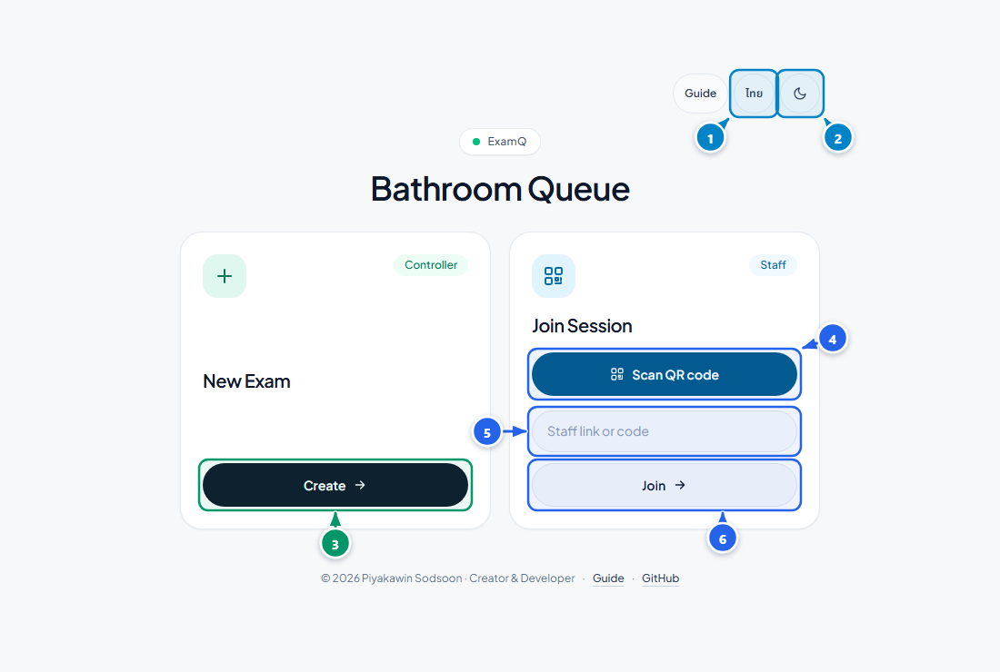
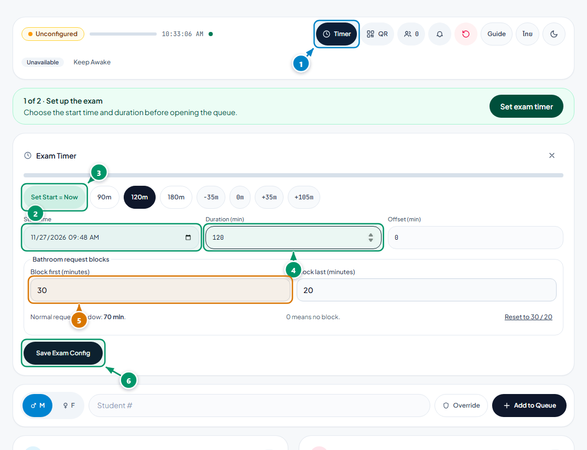
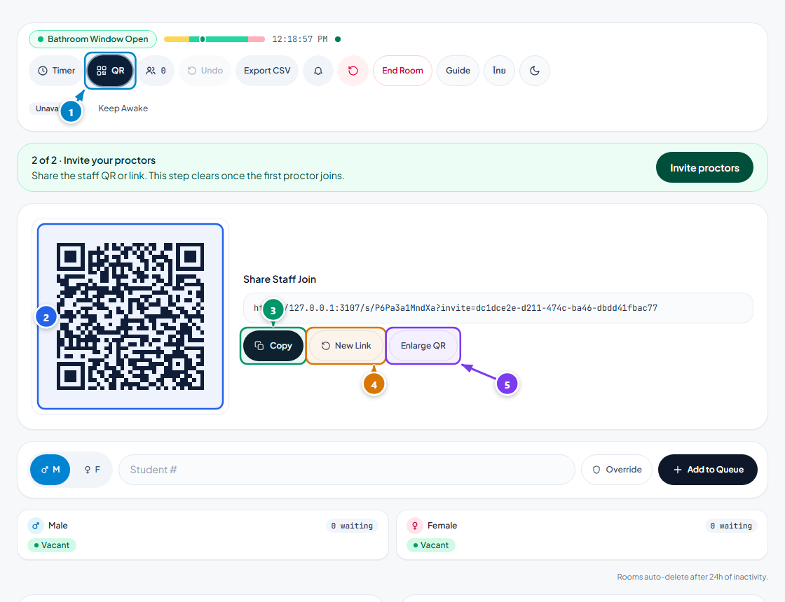
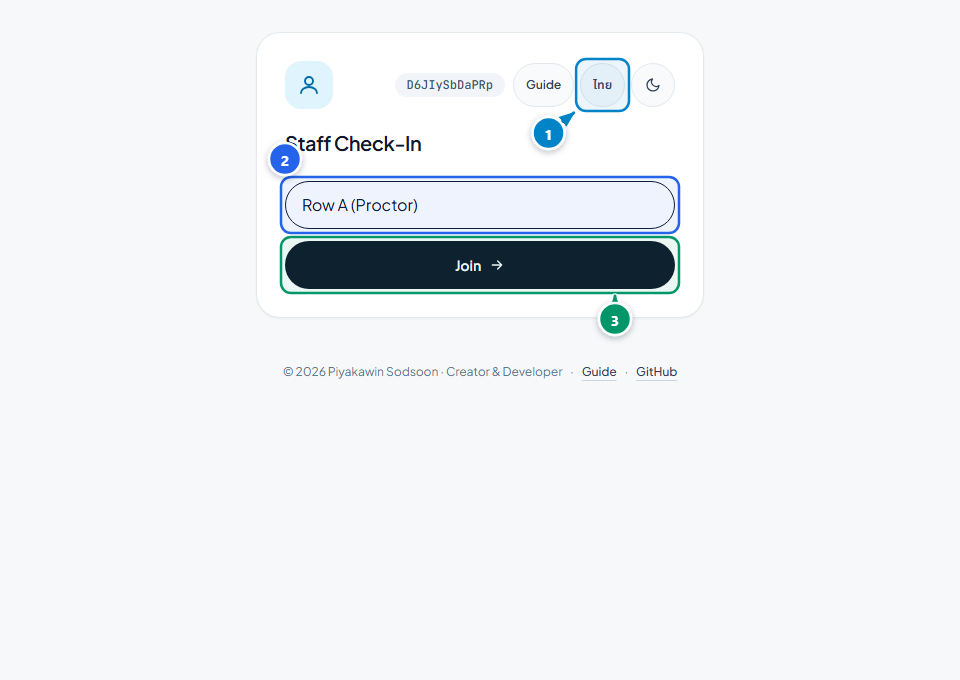
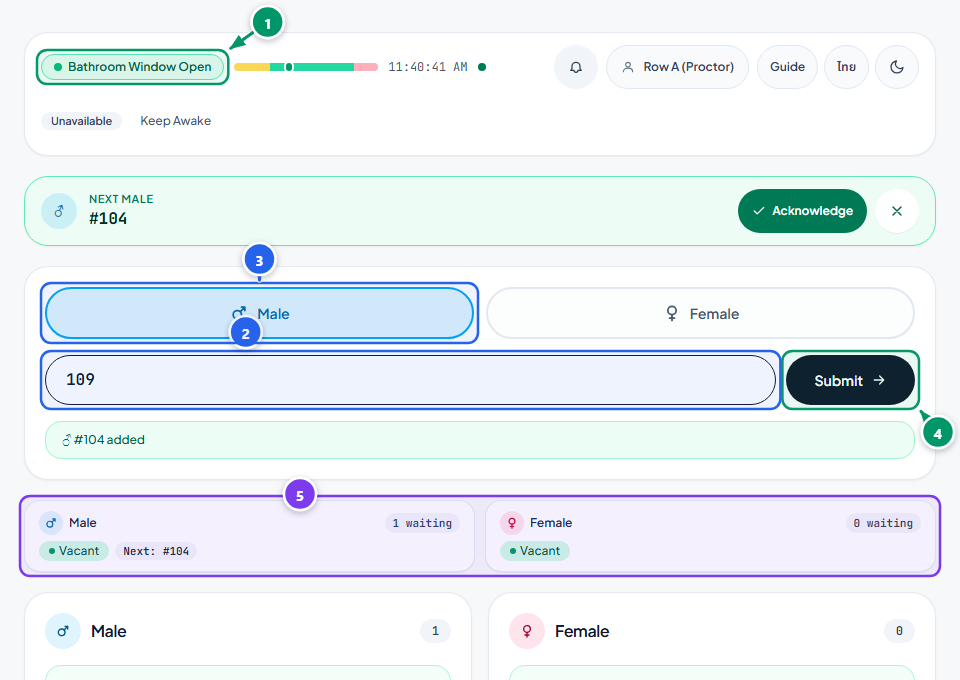
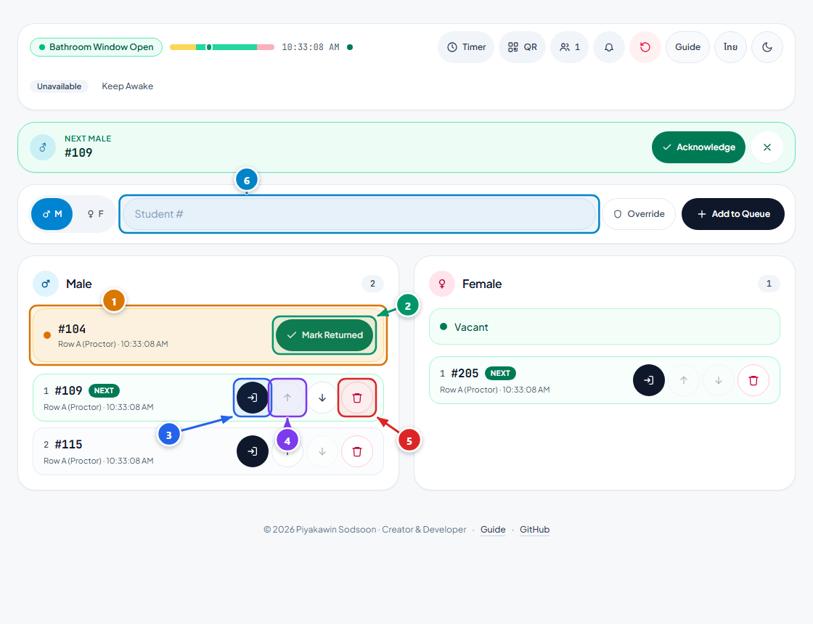
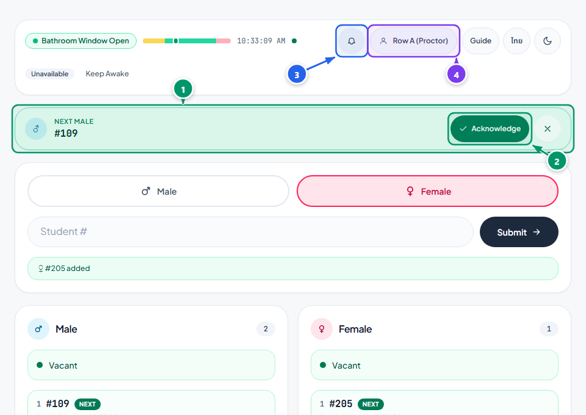
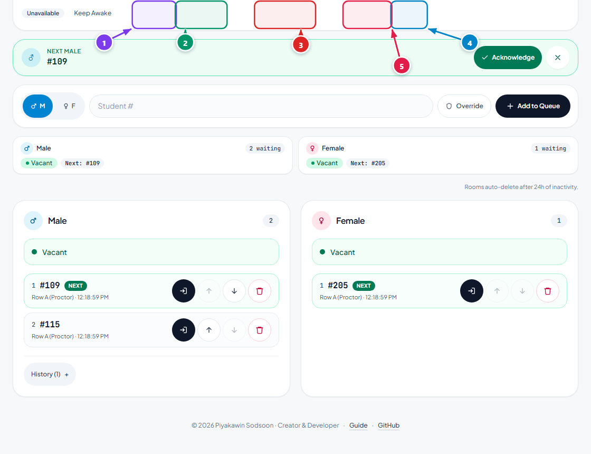

# ExamQ User Manual / คู่มือการใช้งาน ExamQ

> Click-by-click bilingual guide for **Exam Controllers** and **Staff Proctors**.
> คู่มือการใช้งานแบบทีละคลิก 2 ภาษา สำหรับ **ผู้คุมห้องสอบ (Controller)** และ **ผู้ช่วยคุมสอบ (Staff)**

Inside the live web app, you can also open the interactive guide at **`/guide`** (click **Guide** / **คู่มือ** in the top bar).

---

## 1. Home Page & Onboarding / หน้าหลักและการเข้าใช้งาน

| # | English | ภาษาไทย |
|---|---|---|
| **1** | **Click “ไทย” / “EN”** — Switch the interface between English and Thai at any time. | **คลิก “ไทย” / “EN”** — สลับภาษาของระบบระหว่างภาษาไทยและภาษาอังกฤษได้ตลอดเวลา |
| **2** | **Click Moon / Sun icon** — Toggle between Light Mode and Dark Mode. | **คลิกไอคอนพระจันทร์ / พระอาทิตย์** — สลับโหมดสว่าง (Light) และโหมดมืด (Dark) |
| **3** | **Controller: Click “Create”** — Starts a new exam session and opens your Controller Dashboard. | **ผู้คุมห้อง: คลิก “สร้าง” (Create)** — สร้างห้องสอบใหม่และเปิดหน้าจัดการของผู้คุมห้อง |
| **4** | **Staff: Click “Scan QR code”** — Opens a large popup camera window to scan the Controller’s QR code. | **ผู้ช่วย: คลิก “สแกน QR โค้ด”** — เปิดหน้าต่างกล้องขนาดใหญ่แบบป๊อปอัปเพื่อสแกน QR โค้ด |
| **5** | **Staff: Paste link or code** — Paste the invite URL or session code if camera access is unavailable. | **ผู้ช่วย: วางลิงก์หรือรหัสห้อง** — วางลิงก์เชิญหรือรหัสห้องหากไม่สามารถใช้กล้องได้ |
| **6** | **Staff: Click “Join”** — Opens the Staff Check-In screen for that exam room. | **ผู้ช่วย: คลิก “เข้าร่วม” (Join)** — เข้าสู่หน้าลงชื่อผู้ช่วยคุมสอบของห้องนั้นๆ |

> **Auto-Save & Resume / บันทึกห้องสอบอัตโนมัติ:** Active sessions are saved automatically in your browser. If you close the tab or return to Home (`/`), click **Resume / เข้าห้องต่อ** to jump straight back in without re-joining.

---

## 2. Exam Timer & Request Blocks / ตั้งเวลาสอบและช่วงงดขอเข้าห้องน้ำ

| # | English | ภาษาไทย |
|---|---|---|
| **1** | **Click “Timer”** — Opens or closes the Exam Timer settings drawer. | **คลิก “เวลา” (Timer)** — เปิดหรือปิดหน้าต่างตั้งค่าเวลาสอบ |
| **2** | **Set “Start Time”** — Pick the exact date and time the exam begins. | **กำหนด “เวลาเริ่มสอบ”** — เลือกวันและเวลาที่เริ่มทำการสอบ |
| **3** | **Or click “Set Start = Now”** — One-click shortcut to set Start Time to now. | **หรือคลิก “ตั้งเริ่ม = ตอนนี้”** — ตั้งเวลาเริ่มสอบเป็นเวลาปัจจุบันทันที |
| **4** | **Enter “Duration (min)”** — Total exam duration in minutes (e.g., `120`). | **กรอก “ระยะเวลา (นาที)”** — ระยะเวลาสอบทั้งหมดเป็นนาที (เช่น `120`) |
| **5** | **Adjust “Block first” & “Block last”** — Minutes at start (`30`) and end (`20`) that block normal requests (`0` = no block). | **ปรับ “งดช่วงต้น” และ “งดช่วงท้าย”** — ช่วงนาทีแรก (`30`) และนาทีท้าย (`20`) ที่งดรับคิวปกติ (`0` = ไม่งด) |
| **6** | **Click “Save Exam Config”** — Saves settings and syncs the live timeline bar to all devices. | **คลิก “บันทึกเวลาสอบ”** — บันทึกการตั้งค่าและซิงค์แถบไทม์ไลน์ไปยังทุกเครื่องทันที |

---

## 3. Inviting Staff & Managing Links / เชิญผู้ช่วยคุมสอบและจัดการลิงก์

| # | English | ภาษาไทย |
|---|---|---|
| **1** | **Click “QR”** — Opens the Share Staff Join panel. | **คลิก “QR”** — เปิดการ์ดแชร์ลิงก์และ QR โค้ดสำหรับผู้ช่วย |
| **2** | **Scan the QR Code** — Proctors scan this QR code to join without typing. | **สแกน QR โค้ด** — ผู้ช่วยสแกนเพื่อเข้าห้องสอบทันทีโดยไม่ต้องพิมพ์ลิงก์ |
| **3** | **Click “Copy”** — Copies the invite URL to your clipboard. | **คลิก “คัดลอก”** — คัดลอกลิงก์เชิญลงคลิปบอร์ดเพื่อส่งต่อทาง LINE หรือแชท |
| **4** | **Click “New Link”** — Generates a new invite code and invalidates old links. | **คลิก “ลิงก์ใหม่”** — สร้างรหัสเชิญใหม่และยกเลิกลิงก์เก่าเพื่อความปลอดภัย |
| **5** | **Click “Enlarge QR”** — Opens a fullscreen high-contrast QR modal for scanning from a distance. | **คลิก “ขยาย QR”** — เปิดหน้าต่าง QR ขนาดใหญ่เต็มตาเพื่อสแกนจากระยะไกล |

---

## 4. Staff Check-In / การลงชื่อเข้าห้องของผู้ช่วยคุมสอบ

| # | English | ภาษาไทย |
|---|---|---|
| **1** | **Click “ไทย” / “EN”** — Switch language if needed. | **คลิก “ไทย” / “EN”** — สลับภาษาตามต้องการ |
| **2** | **Enter your name or row** (e.g., `Row A`) — Identifies who submitted each student. | **กรอกชื่อหรือแถวที่ดูแล** (เช่น `แถว A`) — เพื่อระบุที่มาของคิวที่ส่ง |
| **3** | **Click “Join Session”** — Checks you in and remembers your session across reloads. | **คลิก “เข้าร่วมห้องสอบ”** — ยืนยันตัวตนเข้าสู่ห้องสอบ |

---

## 5. Submitting Students to the Queue / การส่งคำขอเข้าคิวห้องน้ำ

| # | English | ภาษาไทย |
|---|---|---|
| **1** | **Check Window Status** — Green (`Bathroom Window Open`) allows normal requests; amber blocks normal requests. | **ดูป้ายสถานะเวลาสอบ** — สีเขียว (`เปิดรับคิวปกติ`) ส่งคิวได้; สีเหลืองอำพันอยู่ในช่วงงด |
| **2** | **Enter “Student #”** — Type the student’s number (duplicate active numbers are blocked). | **กรอก “เลขประจำตัว”** — พิมพ์เลขที่นักศึกษา (ระบบป้องกันการส่งเลขซ้ำ) |
| **3** | **Select “Male” or “Female”** — Routes to separate Male/Female queues (1 per gender in bathroom). | **เลือก “ชาย” หรือ “หญิง”** — แยกคิวชาย/หญิงอิสระ (เข้าได้พร้อมกันเพศละ 1 คน) |
| **4** | **Click “Submit”** — Sends the student to the live queue immediately. | **คลิก “ส่งเข้าคิว”** — เพิ่มนักศึกษาเข้าสู่คิวรอและซิงค์ทันที |
| **5** | **Dual M/F Summary + Staff Escort** — View Male & Female occupancy side-by-side; Staff can also tap Enter (→) / Mark Returned (without moving or removing the queue). | **แถบสรุปชาย/หญิง + ปุ่มพาเข้าห้องน้ำ** — ดูสถานะชาย/หญิงคู่กัน และผู้ช่วยกด เข้า (→) / กลับแล้ว ได้ทันที (ไม่ย้ายลำดับหรือลบคิว) |

---

## 6. Managing the Live Queue (Controller) / การจัดการคิวสด (ผู้คุมห้อง)

| # | English | ภาษาไทย |
|---|---|---|
| **1** | **Monitor “In Bathroom”** — Shows current occupant or `Vacant` (max 1 per gender). | **ดูช่อง “กำลังเข้าห้องน้ำ”** — แสดงผู้เข้าห้องน้ำขณะนั้น หรือ `ว่าง` (สูงสุดเพศละ 1 คน) |
| **2** | **Click “Mark Returned”** — Marks student returned, frees slot, and alerts everyone of the next student! | **คลิก “กลับแล้ว”** — บันทึกว่านักศึกษากลับแล้ว และส่งแจ้งเตือน “คิวถัดไป” ทุกเครื่องทันที |
| **3** | **Click Enter (→)** — Admits the waiting student into the bathroom. | **คลิกปุ่มเข้าห้องน้ำ (→)** — เรียกนักศึกษาที่รอคิวให้เข้าห้องน้ำ |
| **4** | **Click Up (↑) / Down (↓)** — Reorders waiting students. | **คลิกเลื่อนขึ้น (↑) / ลง (↓)** — ปรับลำดับคิวรอเมื่อมีกรณีเร่งด่วน |
| **5** | **Click Trash** — Removes a waiting student from the queue. | **คลิกถังขยะ** — ลบนักศึกษาออกจากคิวรอ |
| **6** | **Quick Add & “Override”** — Add students directly or override blocked windows in emergencies. | **เพิ่มด่วน และ “กรณีพิเศษ”** — เพิ่มคิวตรงหรือใช้สิทธิ์กรณีพิเศษในช่วงงดปกติ |

---

## 7. Turn-Ready Alerts, Sound & Push / แจ้งเตือนคิวถัดไป เสียง และ Push

| # | English | ภาษาไทย |
|---|---|---|
| **1** | **Next-Up Banner** — Automatically appears on all devices when someone returns and another student is waiting, with chime & vibration. | **แถบแจ้งเตือน “คิวถัดไป”** — เด้งขึ้นทุกเครื่องอัตโนมัติเมื่อมีคนกลับจากห้องน้ำ พร้อมเสียงและระบบสั่น |
| **2** | **Click “Acknowledge”** — Confirms and broadcasts `Covered by [Name]` to all other devices. | **คลิก “รับทราบ”** — ยืนยันรับเรื่องและแจ้งชื่อผู้รับเรื่องให้ทุกเครื่องเห็นตรงกัน |
| **3** | **Click Bell icon** — Mute or unmute sound and vibration in this tab. | **คลิกไอคอนกระดิ่ง** — เปิดหรือปิดเสียงและระบบสั่นในแท็บนี้ |
| **4** | **Click Staff Badge** — Switch your proctor name/row label. | **คลิกป้ายชื่อผู้ช่วย** — เปลี่ยนชื่อหรือแถวของผู้ช่วยคุมสอบ |

---

## 8. Undo, Excel/CSV Log Export & Session Reset / ย้อนกลับ ส่งออก Excel/CSV และล้างคิว

| # | English | ภาษาไทย |
|---|---|---|
| **1** | **Click “Undo”** — Reverts the latest Enter, Return, Remove, or Reorder (Staff can undo their own Enter/Return). | **คลิก “ย้อนกลับ” (Undo)** — ย้อนกลับการกดเข้า ออก ลบ หรือจัดลำดับคิวล่าสุดได้ทันที |
| **2** | **Click “Export CSV”** — Downloads an Excel-ready UTF-8 CSV log with exam settings, staff list, and all timestamps/durations. | **คลิก “ส่งออก CSV”** — ดาวน์โหลดไฟล์ CSV (รองรับภาษาไทยใน Excel) พร้อมข้อมูลเวลาสอบและบันทึกเข้า-ออกทั้งหมด |
| **3** | **Click Reset (↻) → “Confirm Clear”** — Two-step reset clears all queue entries for the next exam while keeping proctors connected. | **คลิกไอคอนรีเซ็ต (↻) → “ยืนยันล้างคิว”** — ล้างคิวทั้งหมดเพื่อเริ่มสอบรอบใหม่ โดยผู้ช่วยยังอยู่ในห้องเดิม |
| **4** | **Click “Guide”** — Opens the interactive `/guide` manual from any page. | **คลิก “คู่มือ” (Guide)** — เปิดคู่มือ `/guide` ได้จากทุกหน้า |
